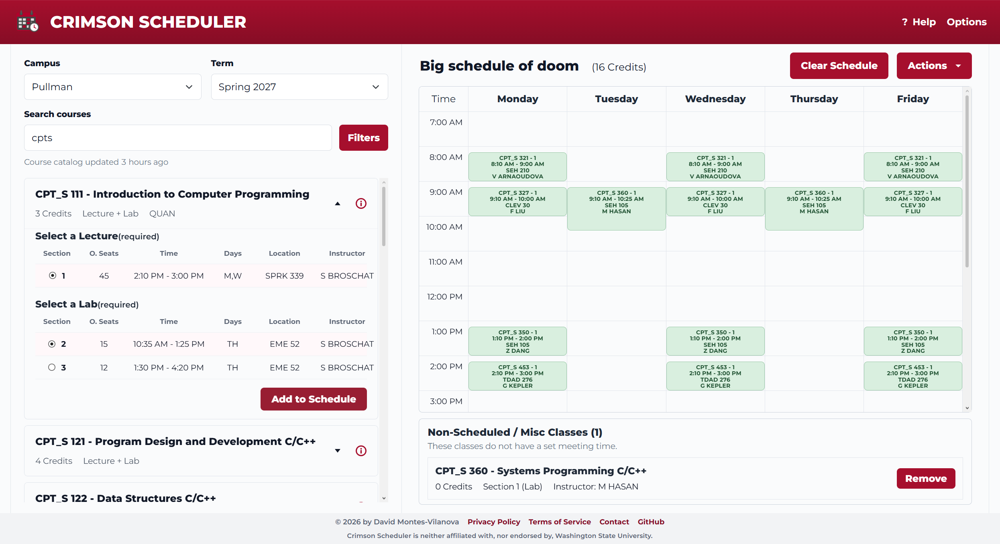
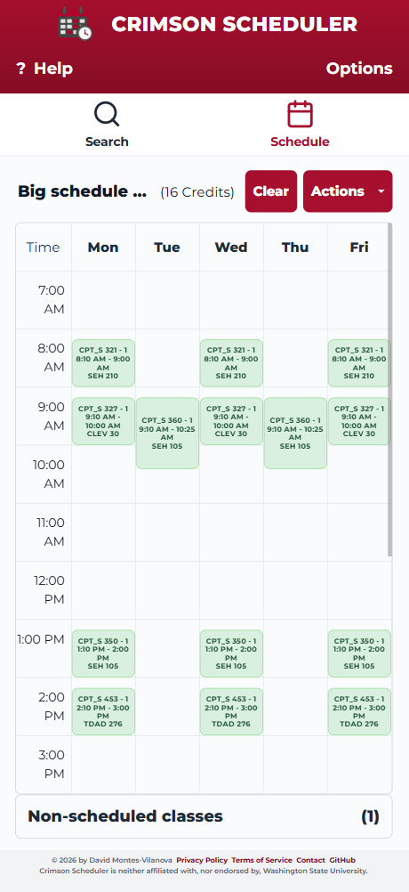
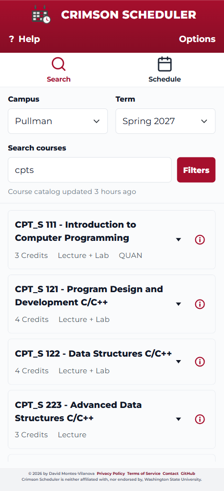
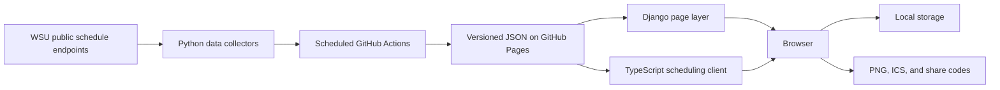

# Crimson Scheduler

Crimson Scheduler is a schedule-planning webapp for Washington State University students. It lets users search published course offerings, compare sections, and arrange classes on a responsive weekly calendar before registering through WSU's official systems.

> Crimson Scheduler is not affiliated with or endorsed by Washington State University, and it cannot enroll students in classes. Always confirm availability and registration details through official WSU resources.



## Features

- Search by subject, course number, course code, or title.
- Filter sections by seat availability, delivery mode, UCORE category, meeting day, and start time.
- Inspect section details including meeting times, locations, instructors, enrollment, credits, descriptions, and prerequisites when published data is available.
- Select linked lecture and lab sections together for courses that require a lab.
- Preview a section on the calendar before adding it.
- Highlight overlapping classes and provide conflict-resolution controls.
- View professor rating quickly through the site before you choose your course.
- Create, rename, switch between, and delete multiple schedule plans.
- Save schedules and display preferences in browser storage for later visits.
- Export the active schedule as a PNG image or recurring `.ics` calendar file.
- Create compact share codes that can be imported on another browser or device.
- Customize dark mode, 12/24-hour time, weekend visibility, instructor labels, and section labels.
- Use responsive desktop and mobile layouts with built-in help and accessible controls.

## Mobile interface

| Schedule | Search |
| --- | --- |
|  |  |

## Architecture

Crimson Scheduler separates page delivery, course-data collection, and interactive scheduling:



### Page and application layer

Django is used as the server side renderer and orchistrator for the pages. (The decision behind Django due to me wanting to learn more about Django. The project evolved to no longer rely on Django as heavily). After page loading, the bundled TS handles all interactability, consisting of course searches, schedule states, and other interactions with the site.

The frontend is split into focused modules under `web/classes/static/src/`. Shared external-data contracts live in `types.ts`; `course_api.ts` validates and normalizes catalog JSON; and the modules in `schedule/` manage state, search, calendar rendering, exports, sharing, preferences, responsive behavior, and course information. Vite compiles `schedule_build.ts` into a bundle for Django to use.

### Course-data pipeline

The Python collectors under `dataCollection/` request WSU's publicly accessible schedule data and generate:

- `api/v1/catalog.json`, which lists campuses, terms, dataset URLs, and a generation timestamp;
- one course dataset for each available campus and term; and
- separate course-specific records for descriptions and prerequisites.

The main catalog workflow is scheduled hourly. Course-specific metadata changes less often and is refreshed separately on the first day of each month. Both workflows publish to the `crimson-data` branch, which is served through GitHub Pages.

Data stored inside of `crimson-data` is simply a cache to store course information. It is not a live feed of the information actively present. WSU updates their course information roughly every hour, and so Crimson Scheduler tries to match that to maintain up-to-date information. There should be NO manual modifications to this branch.

### Persistence and legacy server code

The current planner stores schedule references, schedule names, and display settings in the browser's local storage. Share codes contain a bounded set of campus/term and section identifiers; they are created and decoded client-side rather than stored by Crimson Scheduler.

The repository also has legacy Django models, migrations, an older database importer, and session-backed schedule endpoints from the previous server-backed design. They are still in the repository incase of any massive future changes, but the primary scheduling workflow does not query those models.

## Technology stack

- Python 3.12 and Django 5.2 for page rendering, routing, sessions, and legacy endpoints
- TypeScript 5.8 for the browser application
- Vite 8 for frontend bundling
- Ruff, ESLint, and the TypeScript compiler for static checks
- GitHub Actions and GitHub Pages for course-data generation and publication
- Vercel for application deployment and aggregate web analytics

(Legacy: PostgrSQL database, Redis rate limiter)
## Repository structure

```text
.
|-- .github/workflows/             # CI, CodeQL, and data-publication workflows
|-- dataCollection/
|   |-- classHandler/              # WSU response-domain helpers
|   `-- dataHandler/               # Collectors and static JSON generators
|-- readme-images/                 # README screenshots
|-- tests/                         # Vitest browser-module tests
|-- web/
|   |-- classes/
|   |   |-- migrations/            # Django schema history
|   |   |-- static/
|   |   |   |-- css/               # Application styles
|   |   |   |-- help/              # In-app help images
|   |   |   |-- icons/ and svgs/   # Static visual assets
|   |   |   |-- src/               # TypeScript source and classic page scripts
|   |   |-- templates/classes/     # Django templates
|   |   |-- models.py              # Legacy/server-side data models
|   |   |-- rate_limit.py          # Redis token-bucket rate limiter
|   |   |-- urls.py                # Application routes
|   |   `-- views.py               # Pages and legacy JSON endpoints
|   |-- manage.py                  # Django command entry point
|   `-- web/                       # Project settings, root URLs, WSGI, and ASGI
|-- main.py                        # Legacy database-import entry point
|-- package.json                   # Frontend dependencies and quality commands
|-- pyproject.toml                 # Python metadata and Ruff configuration
|-- requirements*.txt              # Python dependency lock lists
|-- tsconfig.json                  # TypeScript compiler configuration
|-- vite.config.js                 # Frontend bundle configuration
|-- vitest.config.js               # Browser-test configuration
`-- vercel.json                    # Deployment build configuration
```

`_generated_site/` is created locally by the course-data generators and is intentionally not committed.

## Local development

### Prerequisites

- Python 3.12
- Node.js 20 or newer (CI currently uses Node.js 22)
- An internet connection to load the published course catalog and datasets

### 1. Install dependencies

From the repository root, create a Python virtual environment and install the development dependencies:

```powershell
python -m venv venv
.\venv\Scripts\Activate.ps1
python -m pip install -r requirements-dev.txt
```

Install the JavaScript dependencies:

```powershell
npm ci
```

### 2. Configure Django

Create a `.env` file in the repository root. SQLite is sufficient for the application and Django session storage during local development:

```env
DJANGO_SECRET_KEY=replace-this-with-a-local-development-secret
DJANGO_DEBUG=True
DJANGO_ALLOWED_HOSTS=localhost,127.0.0.1
DB_ENGINE=django.db.backends.sqlite3
DB_NAME=db.sqlite3
```

### 3. Build and run

Build the TypeScript application, apply Django migrations, and start the development server:

```powershell
npm run build
cd web
python manage.py migrate
python manage.py runserver
```

Open `http://127.0.0.1:8000/`.

Vite will bundle existing TS into a single JavaScript bundle. When developing and making changes, do NOT edit the generated JavaScript bundle, as any changes there will be overridden. Instead, modify the existing TypeScript files, or create your own to be used by the application.

### Optional PostgreSQL and Redis configuration

Set `DATABASE_URL` to use PostgreSQL; otherwise Django reads `DB_ENGINE`, `DB_NAME`, `DB_USER`, `DB_PWD`, `DB_HOST`, and `DB_PORT`. `DATABASE_URL` takes precedence over the individual database variables.

Redis is only required when exercising the rate-limited legacy schedule endpoints. The default URL is `redis://127.0.0.1:6379/0`, and rate limiting is configured to fail open during a Redis outage. Relevant variables are:

- `REDIS_URL`
- `RATE_LIMIT_MAX_TOKENS`
- `RATE_LIMIT_REFILL_RATE`
- `RATE_LIMIT_TTL_SECONDS`
- `RATE_LIMIT_TRUST_X_FORWARDED_FOR`
- `RATE_LIMIT_FAIL_OPEN`

## Generating course data locally

Generate the catalog and campus/term course files with:

```powershell
python -m dataCollection.dataHandler.generate_json
```

The command writes to `_generated_site/api/v1/`, including `catalog.json` and the individual files under `courses/`. It requests live public WSU endpoints, so runtime depends on the available campuses, terms, and subjects. It does not populate the Django models.

Generate course descriptions and prerequisites separately with:

```powershell
python -m dataCollection.dataHandler.generate_specifics
```

This collector discovers courses through the published catalog by default and writes one record per course under `_generated_site/api/v1/specifics/`. It can take substantially longer than the main catalog collector.

The older database-backed importer is still available through `python main.py`, but it is not required by the planner.

## Quality checks

Run the frontend checks from the repository root:

```powershell
npm run lint
npm run typecheck
npm test
npm run build
```

Run the Python and Django checks with the virtual environment active:

```powershell
python -m ruff check .
python -m ruff format --check .
cd web
python manage.py check
python manage.py test
```

CI runs Ruff, ESLint, TypeScript type checking, Django checks and tests, Vitest, static-file collection, and CodeQL analysis.

## TypeScript conventions

- Treat files under `web/classes/static/src/` as the editable frontend source of truth.
- Put reusable browser-side data contracts in `types.ts`.
- Treat external JSON as `unknown` until it crosses an existing validation or normalization boundary.
- Use explicit function signatures and type-only imports for shared types.

## Public routes

| Route | Purpose |
| --- | --- |
| `/` | Schedule builder |
| `/privacy-policy/` | Privacy policy |
| `/terms-of-service/` | Terms of service |
| `/contact/` | Contact, issue-reporting, and accessibility guidance |

There are also some legacy Django endpoints available. These endpoints are commented out in the `urls.py`, and may be removed in future updates.

## Privacy and limitations

Schedules, schedule names, theme selection, and display preferences are stored in the user's browser. Clearing site storage removes that local state. Share codes expose the schedule name and selected term/section references to anyone who receives the code, but the application does not persist those codes on its server.

The deployed site uses Vercel Web Analytics for aggregate traffic information. See the deployed [Privacy Policy](https://www.crimsonscheduler.com/privacy-policy/) and [Terms of Service](https://www.crimsonscheduler.com/terms-of-service/) for current details.

Crimson Scheduler is a planning aid. It cannot guarantee seat availability, eligibility, prerequisites, instructor assignments, meeting locations, or that a section will remain unchanged. Verify every selection in WSU's official registration tools before enrolling.

## Roadmap ideas

- [ ] Create schedule generation to help users optimize their schedules.
- [ ] Introduce pagination to the course results.
- [ ] Allow users to compare their schedules with friends within the application.
- [ ] Add degree-planning relationships for exploring prerequisites and future semesters.
- [ ] Visualize walking routes between class locations.

## Contributing

Issues, bug reports, and contributions are welcome. Before starting a substantial change, open or review an issue so the proposed behavior and scope can be discussed. When completing your change, make a pull request and request that I review it.

When reporting a bug, include reproduction steps, the selected campus and term when relevant, browser/device information, and screenshots or console errors if available. Do not include private student or account information.

## License

Crimson Scheduler is available under the [MIT License](LICENSE.md).
