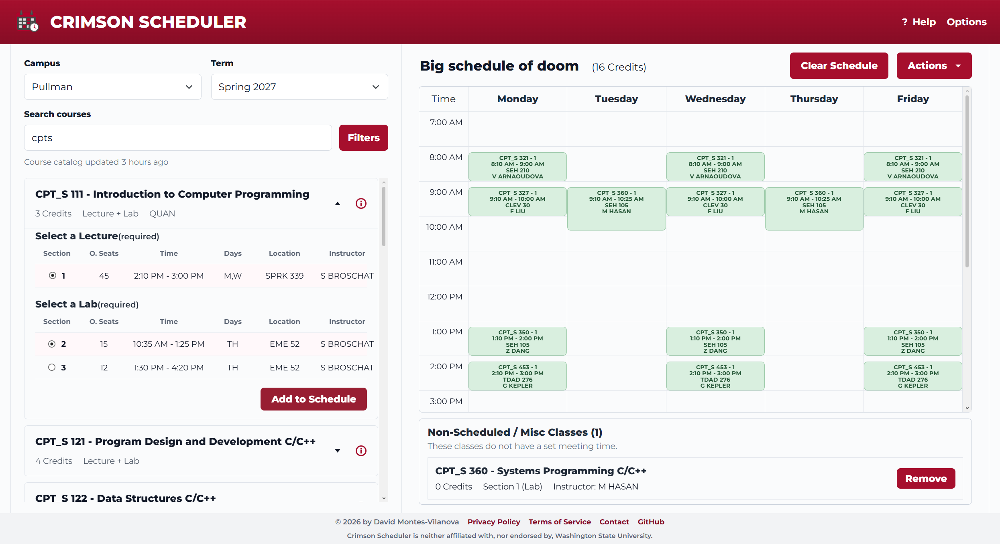
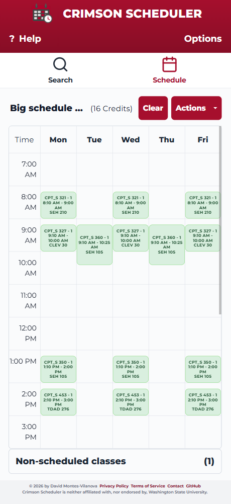
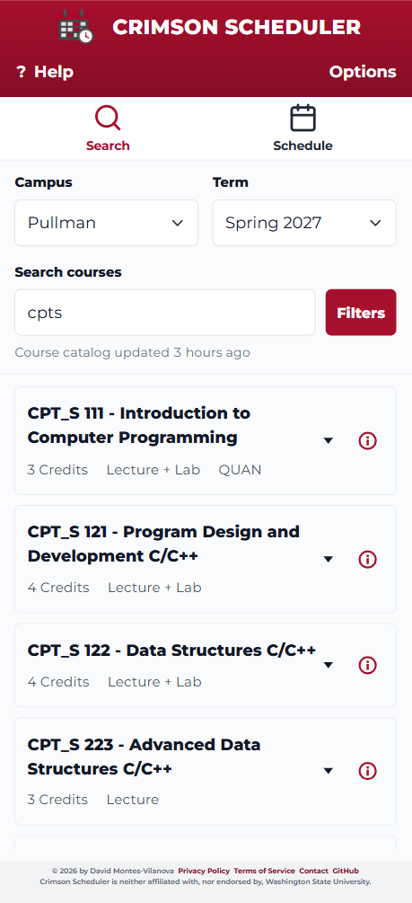

# Crimson Scheduler

Crimson Scheduler is a WSU-focused schedule builder that helps students search course offerings and create a weekly class schedule. It retrieves publicly accessible course schedule data from WSU's course API endpoints and caches them for users to query.

Users can choose a campus and term, search the published course catalog, and select sections to assemble their course schedule.



## Features

- Search courses by subject, number, course code, or title.
- Filter results by open seats, delivery type, UCORE, meeting times, and more!
- Review section number, meeting time, location, instructor, enrollment, and UCORE information before adding a class.
- Choose lecture and lab sections together when a course requires a lab; removing either removes the paired selection.
- Before adding a section, you can see a temporary block to show how the course may look in your schedule before officially adding it.
- Course conflicts are flagged and made visual for the user to notice and resolve.
- Arranged, TBA, online, and other unscheduled sections are placed in a separate list from the schedule.
- Track total credits, rename the schedule, and clear the schedule when needed.
- Export a calendar image (PNG) or a recurring `.ics` calendar file for compatible calendar apps.
- Share calendars with friends using Share Codes! This can also be used to transfer your schedule across devices.
- Your chosen courses, schedule configurations, and site settings are saved for your next visit.
- Responsive desktop and mobile layouts, dark mode, 24-hour time, optional weekends, instructor/section labels, accessible filter controls, and in-app guidance.

## Mobile UI

| Schedule | Search |
| --- | --- |
|  |  |

## How it works

The deployed application is a Django UI backed by a versioned, static course-data API hosted from the repository's `crimson-data` GitHub Pages branch. The browser fetches a catalog first, then retrieves only the selected campus/term JSON file. Search and filtering run client-side, which keeps normal course browsing off the Django database and avoids repeated requests to WSU while a user types.

Course data originates from WSU's public schedule endpoints. The scheduled GitHub Actions workflow regenerates the static catalog roughly every 2-3 hours and publishes it to the data branch. Section availability and other catalog details can therefore lag behind the official registration systems.

The repository still includes Django models and session-backed schedule endpoints from the earlier server-backed implementation. They are retained and covered by tests, but the primary schedule-builder flow is browser-first and uses the static catalog. The reason these models and endpoints are maintained are for history reasons.

## Tech stack

- Python 3.12 and Django 5.2
- Vanilla JavaScript modules bundled with Vite
- Bootstrap, HTMX, and html2canvas for the interface and image export
- `ical-generator` for `.ics` exports
- Static JSON course catalog published through GitHub Pages
- Redis token-bucket rate limiting for Django's legacy schedule API endpoints
- PostgreSQL for Django's optional/legacy data models

## Project structure

```text
.
|-- .github/
|   `-- workflows/               # CI, security checks, and course-data publishing
|-- dataCollection/
|   |-- classHandler/             # Legacy WSU response/model helpers
|   `-- dataHandler/              # Scrapers and static JSON catalog generators
|-- _generated_site/              # Locally generated static API output
|-- readme-images/                # README screenshots
|-- tests/                        # Vitest tests for browser-side behavior
|-- web/
|   |-- classes/
|   |   |-- migrations/           # Django database migrations
|   |   |-- static/
|   |   |   |-- css/              # Base, schedule, and search-result styles
|   |   |   |-- help/             # Help-guide screenshots
|   |   |   `-- js/               # API client, schedule modules, and built bundle
|   |   |-- templates/classes/    # Shared layout, builder, help, and legal pages
|   |   |-- admin.py              # Optional Django admin registrations
|   |   |-- models.py             # Legacy/server-side schedule data models
|   |   |-- urls.py               # Application routes
|   |   |-- views.py              # Django pages and server-side endpoints
|   |   `-- rate_limit.py         # Redis-backed request limiting
|   |-- manage.py                 # Django management commands
|   `-- web/                      # Django settings, WSGI/ASGI, and root URLs
|-- main.py                       # Legacy database importer entry point
|-- package.json                  # Vite, ESLint, and Vitest commands
|-- pyproject.toml                # Python tooling and Ruff configuration
|-- requirements*.txt             # Runtime and development Python dependencies
|-- vercel.json                   # Deployment/build configuration
`-- README.md
```

The browser-first schedule builder reads the published catalog from the static API and keeps a user's active schedule in local storage. The Django models, migrations, importer, and optional admin registrations remain for the server-backed schedule endpoints and maintenance workflows; they are not required to browse the published catalog.

## Local development

### Prerequisites

- Python 3.12
- Node.js 20 or newer (Node 22 is used in CI)

Create and activate a virtual environment, then install Python dependencies:

```powershell
python -m venv venv
.\venv\Scripts\Activate.ps1
python -m pip install -r requirements-dev.txt
```

Install JavaScript dependencies and build the browser bundle:

```powershell
npm ci
npm run build
```

Create a `.env` file in the repository root. A SQLite configuration is enough for local development because the primary UI reads the published static catalog rather than a local course database:

```env
DJANGO_SECRET_KEY=change-this-for-local-dev
DJANGO_DEBUG=True
DJANGO_ALLOWED_HOSTS=localhost,127.0.0.1
DB_ENGINE=django.db.backends.sqlite3
DB_NAME=db.sqlite3
```

Apply migrations and start Django:

```powershell
cd web
python manage.py migrate
python manage.py runserver
```

Open `http://127.0.0.1:8000/`. The page will request the current catalog from the published API, so an internet connection is required for course search.

### Optional services and database configuration

Redis is only needed when exercising the rate-limited legacy JSON endpoints. Its defaults are `redis://127.0.0.1:6379/0` and fail-open behavior, which means a local Redis outage does not block normal development.

For PostgreSQL, set `DATABASE_URL` or the individual `DB_ENGINE`, `DB_NAME`, `DB_USER`, `DB_PWD`, `DB_HOST`, and `DB_PORT` variables. `DATABASE_URL` takes precedence. Set `REDIS_URL` and, if needed, tune `RATE_LIMIT_MAX_TOKENS`, `RATE_LIMIT_REFILL_RATE`, `RATE_LIMIT_TTL_SECONDS`, `RATE_LIMIT_TRUST_X_FORWARDED_FOR`, and `RATE_LIMIT_FAIL_OPEN`.

### Refreshing the static course API locally

The production catalog is generated by GitHub Actions. To generate the same static API locally:

```powershell
python -m dataCollection.dataHandler.generate_json
```

This writes `_generated_site/api/v1/catalog.json` plus one JSON file per campus/term. The script requests WSU's public schedule API and may take time depending on the number of active terms and subjects. It does not update the local Django database.

The older database importer remains available as `python main.py`; it initializes Django and imports the WSU data into the configured database. It is useful for maintaining the legacy endpoints, not required for the browser-based builder.

## Quality checks

```powershell
npm run lint
npm test
python -m ruff check .
python -m ruff format --check .
cd web
python manage.py check
python manage.py test
```

GitHub Actions runs Python and JavaScript linting, Django checks/tests, Vitest, CodeQL analysis, and the hourly data-publication workflow.

## Routes
The table showcases all actively used routes, legacy or otherwised unused routes are not listed.

| Route | Purpose |
| --- | --- |
| `/` | Schedule builder |
| `/privacy-policy/` | Privacy policy |
| `/terms-of-service/` | Terms of service |
| `/contact/` | Contact and feedback guidance |

## Privacy and data notes

Schedules, display preferences, schedule names, and theme selection are stored in the browser's local storage. A legacy cookie reader is retained for older schedules, but the current builder persists new schedules in local storage. Share codes encode a schedule name and campus/term section identifiers; they are not stored on the server.

The site uses Vercel Web Analytics for aggregate traffic information. Consult the in-app [Privacy Policy](https://crimsonscheduler.com/privacy-policy/) for the current details.

## Future work

- [x] Deploy and maintain the public production experience.
- [x] Add image and calendar export.
- [x] Add share/import codes.
- [x] Add client-side availability, delivery, and UCORE filters.
- [x] Explore reliable instructor-rating links or a user-submitted rating system.
- [x] Improve visibility into how fresh enrollment counts are after each catalog refresh.
- [x] Add course descriptions and prerequisites to course data for a more educated user experience.
- [ ] Add degree-planning relationships to help map out course relationships and plan for future semesters.
- [ ] Visualize walking routes between class locations.

## Contributing

You're free to help contribute to Crimson Scheduler!

Be sure to follow the local development above to get started. Recall that Crimson Scheduler now uses the github pages API endpoint for fetching course information, NOT the PostgreSQL and Redis storage.

If you plan on fixing a bug or adding a feature, please be sure to create an issue first to alert others about what you find or want to add.

If any other clarifications are needed for contribution, please reach out!

## Disclaimer

Crimson Scheduler is an independent third-party project. It is not affiliated with, endorsed by, sponsored by, or otherwise officially associated with Washington State University.

Always verify course availability, meeting times, instructors, locations, prerequisites, and registration requirements through official WSU resources before enrolling.

You cannot enroll using Crimson Scheduler.

## License

[MIT](LICENSE.md)
